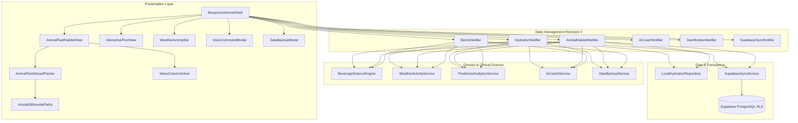

# 🌊 AquaWild (HydroFauna)

<div align="center">


**The World-Class, Cross-Platform AI-Powered Hydration & Liquid Tracking Ecosystem**

[](https://flutter.dev)
[](https://flutter.dev/multi-platform)
[](./test)
[](./lib)
[](./docs/governance)
[](./supabase)
[](./LICENSE)

*Surpassing inspirations from Mobbin Waterllama vertical filling and Brownie pool float prototypes with modern-futuristic Hydro-Glass UX/UI, 60/120 FPS Impeller wave shaders, OpenAI-compatible AI coaching, living biomes, habit gamification, and universal 6-platform deployment.*

</div>

---

## 🌟 Key Highlights & Innovations

### 1. 🧪 Bioavailability-Engineered Beverage Science (16 Beverages)
* **Physiological Hydration Indices**: Unlike naive water trackers, every liquid features an empirical hydration index (e.g., Pure Water: 1.0, Coconut Water: 1.15, Electrolyte Drink: 1.25, Skim Milk: 1.20).
* **Caffeine Diuretic Offsetting**: High-potency caffeine drinks (Espresso, Cold Brew) dynamically apply mild diuretic volume deductions based on mg of caffeine per 100ml.
* **Density & Viscosity Physical Stratification**: Stacked beverage strata sort dynamically by physical density (e.g. dense honey smoothie sinks below light pure water).

### 2. 🐾 10 Handcrafted Exotic Companions & 4 Evolution Stages
* **10 Companion Species**: Ruby the Red Panda, Cappy the Capybara, Lottie the Axolotl, Ollie the Sea Otter, Luna the Andean Llama, Freya the Arctic Fox, Percy the Emperor Penguin, Echo the Dolphin, Octavia the Blue-Ringed Octopus, and Kira the Snow Leopard.
* **Handcrafted Vector Silhouettes**: Continuous cubic Bezier vector clipping boundaries (`AnimalSilhouettePaths`) scaling to any viewport without raster pixelation.
* **Dynamic Species Physics & Overlays**:
  * *Capybara*: Buoyant Yuzu citrus fruits bobbing with harmonic wave physics, rising thermal onsen steam trails, oscillating zen folded head towel.
  * *Axolotl*: 6 external feathery branching gills pulsing with electric cyan (`#00E5FF`) and neon magenta (`#FF4081`) luminous halos, floating plankton spores.
  * *Sea Otter*: Swaying vertical emerald kelp ribbons, tilted iridescent scallop shell with golden pearl on chest.
  * *Andean Llama*: Woven Aztec geometric collar with 4 dangling pompom tassels swaying in rhythm.
  * *Octopus*: 10 bioluminescent glowing blue rings with dark indigo centers that expand and flare on touch.
  * *Dolphin*: Expanding acoustic sonar bubble rings with fading opacity.
  * *Arctic Fox*: Shimmering celestial Aurora Borealis veil across chest.
  * *Penguin*: Radiant golden-yellow auricular neck plumage patches.
  * *Snow Leopard*: Alpine rosettes along flank and tail.
* **4 Evolution Tiers**: *Hatchling* $\to$ *Explorer* $\to$ *Guardian* $\to$ *Mythic Spirit* with unlockable titles and cosmetic stage perks.
* **`CompanionEvolutionModal`**: Radiant 12-second sunburst aura celebration modal with audio/haptic fanfare.

### 3. 🌊 64-Column Shallow-Water Wave Simulation & Meniscus Surface Physics
* **Coupled Wave Equation Solver**: Hardware-accelerated 64-column spring-damper wave simulation running Hooke restorative force, velocity damping, and Laplacian wave propagation across adjacent columns.
* **Tactile Tap Excitation**: Tapping the vessel canvas injects an instantaneous localized wave impulse and excites a decaying `interactionPulse` ($1.0 \to 0.0$).
* **Meniscus Refraction & Effervescence**: Specular quadratic surface tension highlights and rising micro-bubbles.

### 4. 🏊 Procedural Top-View Pool Caustics & Red Panda Float Physics
* **Dual-Layer Caustic Lattice**: Procedural ceramic pool floor tiles with layered sinusoidal caustic glints.
* **Harmonic Buoyancy Spring-Damper**: Harmonic bobbing, rocking tilt, and expanding circular ripple rings on tap.
* **Detailed Mascot Assembly**: Reclining Red Panda with candy-striped swim ring, aviator sunglasses with specular shine sweep, and tropical drink.

### 5. 🤖 OpenAI-Compatible AI Hydration Coach & Clinical Heuristic Fallback
* **OpenAI API Client**: Direct connection to any OpenAI-compatible `/chat/completions` endpoint with prompt sanitization, model selection, and structured JSON schema response enforcement.
* **Deterministic Offline Clinical Fallback**: Rule-based heuristic advisor generating personalized clinical advice tailored to companion personality, circadian time, hydration deficit, and environmental stressors without network dependencies.
* **Sweat Loss & Environmental Perspiration Engine**: Real-time adjustments based on ambient temperature, humidity, Steadman heat index, altitude (>1500m), and 8 physical workout activities.

### 6. 🔥 Gamification, Streaks & Predictive Dehydration Analytics
* **Habit Streaks with Streak Freezes**: Continuous daily streak calculation, longest streak records, and streak freeze shields to protect user momentum.
* **12 Tiered Achievement Badges**: Unlocked across habit longevity, circadian dawn intake, and companion evolution.
* **Seasonal Challenge Quests**: Live countdown timer, XP goals, and claimable rewards ("Verdant Spring Rejuvenation").
* **Predictive Circadian Analytics**: 7-day rolling window bars, 24-hour hourly intake curves, predictive End-of-Day intake projections, and dynamic dehydration risk metrics.

### 7. 📱 Universal Responsive 3-Breakpoint Shell & 4 Dynamic Themes
* **Responsive Layout**: Adapts between Compact (<700px phone), Medium (700px-1100px tablet with `NavigationRail`), and Expanded (>=1100px desktop 3-pane command center).
* **4 Dynamic Themes**: Modern-futuristic Hydro-Glass (`hydroGlassTheme`), OLED Dark (`darkTheme`), Day Light (`lightTheme`), and WCAG 2.2 AAA High Contrast (`highContrastTheme`).
* **Natural Language Voice Logger**: Speech-to-intent engine parsing natural voice utterances with automatic unit conversion (oz, l $\to$ ml).
* **Desktop Keyboard Shortcuts**: Instant keys (`1-9`, `Space`, `A`, `R`, `B`, `P`, `G`, `T`, `V`, `X`, `?`).

### 8. 🔒 Enterprise Supabase Backend & Offline-First Sync Queue
* **Strict PostgreSQL RLS**: Enforced `auth.uid() = user_id` for SELECT, INSERT, UPDATE, and DELETE across `profiles`, `hydration_entries`, `user_streaks`, `user_achievements`, and `activity_sessions`.
* **Automated Database Triggers**: `handle_new_user()` provisions starter companions and streak freezes automatically.
* **Deno Edge Functions**: `ai-hydration-coach` (secure serverless OpenAI proxy) and `sync-health-telemetry`.
* **Client Offline Sync Queue**: Persistent offline mutation queue with real-time sync indicators (`Cloud Synced`, `Syncing...`, `Pending`).

### 9. 💾 Privacy-First Data Portability & RFC 4180 CSV Export
* **Lossless JSON Backup**: Exports complete profile, goals, XP, companion state, streaks, and entry history into structured JSON.
* **RFC 4180 CSV Export**: Generates spreadsheet-compatible logs with milliliters, hydration index, net volume, caffeine, and electrolytes for health reviews.
* **Validated Restoration**: Instant backup verification and state rehydration.

---

## 🏛️ System Architecture



---

## ⌨️ Desktop Keyboard Accelerators

| Shortcut | Action | Description |
| :---: | :--- | :--- |
| **`1` – `9`** | Quick-Log Beverage | Instantly logs preset volume for beverages 1 through 9 |
| **`Space`** | Pour Pure Water | Quick-logs 250ml of fresh pure water |
| **`A`** | AI Hydration Coach | Opens AI advisor dialogue with personalized recommendations |
| **`R`** | Smart Reminders | Opens circadian schedule timeline & interval timers |
| **`B`** | Biomes & Companions | Opens exotic companion evolution & habitat biome switcher |
| **`P`** | Predictive Analytics | Opens dehydration risk report, hourly curve & 7-day intake |
| **`G`** | Achievements & XP | Opens habit streaks, streak freeze shield, and badges |
| **`T`** | Cycle Theme | Cycles between Hydro-Glass, Dark, Light, and High Contrast |
| **`V`** | Voice Logger | Opens natural language speech input simulation modal |
| **`X`** | Data Backup & Export | Opens JSON/CSV export and backup restoration modal |
| **`?` / `F1`** | Shortcuts Guide | Displays keyboard accelerators cheat-sheet |

---

## 🚀 Getting Started

### Prerequisites
- **Flutter SDK**: `^3.10.0` or higher
- **Dart SDK**: `^3.0.0`
- **Supported Platforms**: Windows, macOS, Linux, Android, iOS, Web

### Installation & Run

```bash
# 1. Clone repository
git clone https://github.com/daya/water.git
cd water

# 2. Install dependencies
flutter pub get

# 3. Run Static Analysis (Zero Warnings Policy)
flutter analyze --fatal-infos --fatal-warnings

# 4. Run Full Automated Test Suite (87 tests)
flutter test

# 5. Launch Application on your target platform
flutter run -d chrome    # Web
flutter run -d windows   # Windows Desktop
flutter run -d macos     # macOS Desktop
flutter run -d linux     # Linux Desktop
flutter run              # Connected Android/iOS device
```

---

## 📦 Multi-Platform CI/CD Pipelines

AquaWild incorporates 7 dedicated GitHub Actions CI/CD workflows under `.github/workflows/`:

* **`build-all.yml`**: Master orchestrator with selective platform dispatch (`all`, `android`, `ios`, `web`, `windows`, `macos`, `linux`), nightly scheduled cron (`0 2 * * *`), quality gates (linting + secret scanning + 100% test pass rate), parallel matrix builds, and GitHub release packaging.
* **`android.yml`**: Android APK & AAB packaging.
* **`ios.yml`**: iOS release payload packaging on macOS runners.
* **`web.yml`**: WebAssembly (Wasm) and HTML5 CanvasKit bundle packaging.
* **`windows.yml`**: Windows x64 executable and zip archive packaging.
* **`macos.yml`**: macOS `.app` bundle archive packaging.
* **`linux.yml`**: Linux GTK3 release tarball packaging.
* **`dependabot.yml`**: Automated dependency security audits.

---

## 📜 Multi-Agent Governance & Decision Records

The project is governed under a strict 10-agent ownership matrix and mandatory 12-step subphase execution protocol documented in [AGENTS.md](./AGENTS.md):

* [ADR-001: Riverpod 3 State Management Architecture](./docs/adr/ADR-001-state-management-riverpod.md)
* [ADR-002: Offline-First SQLite & Supabase Sync Engine](./docs/adr/ADR-002-offline-first-sync-supabase.md)
* [ADR-003: 60/120 FPS Impeller Custom Fluid Shaders](./docs/adr/ADR-003-impeller-shaders-fluid-physics.md)
* [ADR-004: Universal Multi-Platform Responsive Design](./docs/adr/ADR-004-universal-multi-platform-design.md)
* [ADR-005: Multi-Agent Governance Protocol](./docs/adr/ADR-005-multi-agent-governance-protocol.md)
* [Execution Plan & Status Tracker](./docs/governance/EXECUTION_PLAN.md)
* [Decision Log & AI Course Corrections](./docs/governance/DECISION_LOG.md)
* [Risks & Assumptions Registry](./docs/governance/RISKS_AND_ASSUMPTIONS.md)
* [Changelog](./CHANGELOG.md)

---

<div align="center">
<b>AquaWild (HydroFauna) — Engineered with Precision by the Antigravity Team</b>
</div>
