# AquaWild (HydroFauna) — Enterprise System Architecture & Competitive Analysis

## 1. Competitive Reference Image Analysis & How AquaWild Surpasses Existing Apps

### Reference Image Insights (Waterllama & Brownie Pool Concept)
1. **Reference Images 1, 2 & 4 (Waterllama iOS on Mobbin)**:
   - *Observed Strengths*: Friendly animal silhouettes (Llama, Octopus, Bear) that fill vertically from the feet up with stacked colored bands representing different beverages (blue for water, green for green tea, brown for coffee, orange for juice); quick beverage dock at the bottom; full-screen cup drag-to-adjust volume sheet (e.g., 300ml Green Tea mug, orange tumbler with vertical drag handle); custom numeric keypad (`800 ml`).
   - *Observed Limitations*:
     - Flat 2D static color clipping with minimal fluid physics (horizontal bands don't slosh dynamically with inertia, viscosity, or refraction).
     - Mobile-only portrait layout (iOS-only roots); lacks adaptive tablet, desktop, and web multi-pane experiences.
     - Aggressive paywall friction banners ("You'll lose access soon 23:57h") that degrade user trust.
     - No AI coaching, no real-time electrolyte/caffeine dehydration netting explanation, and no interactive ecosystem where unlocked animals live together.
2. **Reference Image 3 ("Brownie" Interactive Pool Mockup)**:
   - *Observed Strengths*: Top-down swimming pool tile grid with caustic lines and a cute character wearing sunglasses relaxing in a pink floating inner tube holding a citrus drink above a clean "Get Started" pill button.
   - *Observed Limitations*:
     - Static/basic web mockup with uniform grid distortion and limited physical depth.
   - *How AquaWild Surpasses It*:
     - **AAA Launch Screen — SVG Red Panda Floating Pool Simulation**: Replaces the basic mockup with a multi-layered, high-detail animated SVG **Red Panda** lounging on a buoyant ring tube over a real-time procedural top-view water surface featuring dual-layer caustic refraction waves, concentric interactive touch/cursor ripples, subsurface depth gradient, realistic drop-shadow parallax that shifts with wave height, floating blossom/bubble particles, and spring-damper buoyancy physics that seamlessly transitions into the main hydration studio.

---

## 2. System Topology & Clean Architecture Layers

```mermaid
flowchart TD
    subgraph Presentation["Presentation Layer (Flutter Material 3 + Impeller)"]
        Launch["Launch Screen: Kinematic Red Panda Rig & Organic Pool Caustics"]
        Shell["Adaptive Cross-Platform Shell (Phone / Tablet / Desktop / Web)"]
        Habitat["Interactive Animal Fluid Vessel & Zero-Gap Stratified Wave Canvas"]
        PourSheet["Interactive Pour Studio & Custom Beverage Creator"]
        Storefront["Premium Storefront Modal (AquaWild Pro, IAP Packs, Passes)"]
        WidgetPreview["Home & Lock-Screen Widget Center & Notification Center"]
        AdminPortal["Admin Command Portal (/admin: God-Mode, Users, Content, Config)"]
        AICoach["OpenAI-Compatible AI Hydration Coach & Insights"]
        Biomes["Hydration Worlds, Evolution Gallery & Analytics"]
    end

    subgraph State["State & Orchestration Layer (Riverpod)"]
        HydrationCtrl["HydrationController (Entries, Zero-Gap Mesh, Goals)"]
        PhysicsCtrl["FluidPhysicsController (Wave Solver, Slosh, Meniscus)"]
        KinematicCtrl["KinematicPandaController (Pathfinding, Idles, Eye-Tracking)"]
        MonetizationCtrl["MonetizationController (Entitlements, Pro, IAP Store)"]
        WidgetNotifyCtrl["WidgetNotificationTelemetryController (Out-of-App Budgets)"]
        AdminCtrl["AdminPortalController (God-Mode, RBAC, Remote Config, Audit)"]
        GamificationCtrl["GamificationController (XP, Streaks, Evolution, Biomes)"]
        ThemeA11yCtrl["Theme & Accessibility Controller (Reduced Motion, High Contrast, Voice)"]
    end

    subgraph Domain["Domain Layer (Pure Dart Immutable Entities & Science Engine)"]
        HydrationCalc["Bio-Availability & Electrolyte Netting Engine"]
        GoalCalc["Weather, Activity & Circadian Goal Engine"]
        AnimalCatalog["Exotic Animal & Biome Catalog (10 Species × 4 Evolution Stages)"]
        MonetizationDomain["Monetization Domain (SubscriptionTier, ProductSKU, Entitlement)"]
        WidgetTelemetryDomain["Out-of-App Telemetry (WaterLeft, BudgetRemaining, Streaks)"]
        AdminDomain["Admin Domain (UserRecords, ContentCatalog, AuditLedger)"]
    end

    subgraph Data["Data & Integration Layer (Offline-First + Cloud)"]
        LocalStore["Local Encrypted/SharedPreferences Store & Sync Queue"]
        SupabaseAPI["Supabase PostgreSQL + RLS + Realtime + Edge Functions"]
        AIEngine["OpenAI-Compatible Chat/Completion Client + Offline Heuristic Fallback"]
        StoreBridge["Store Billing Bridge (InAppPurchase + Web/Desktop Sandbox)"]
        NotificationBridge["Local & Push Notification Bridge + Background Intent Handlers"]
        PlatformBridge["HealthKit / Health Connect + Haptics + Spatial Audio Synthesizer"]
    end

    Presentation --> State
    State --> Domain
    State --> Data
```

---

## 3. Core Technical Subsystems

### 3.1 Zero-Gap Coupled Shallow-Water Fluid & Multi-Beverage Mesh Architecture
- **Coupled 64-Column Wave Solver**: Models liquid surface elevation $y_i$ and vertical velocity $v_i$ across $N=64$ discrete horizontal columns using spring-damper surface tension and neighbor wave propagation:
  $$a_i = -k \cdot (y_i - y_{\text{target}}) - c_{\text{viscosity}} \cdot v_i + s \cdot (y_{i-1} + y_{i+1} - 2y_i)$$
- **Zero-Gap Mathematical Stitching**: Rather than drawing disconnected flat lines and sinusoidal curves, layer $l$ constructs its bottom boundary by traversing the exact wave vertices of lower boundary $W_{l-1}$ in reverse, and its top boundary by traversing $W_l$ forward, ensuring 0.0px gap continuity across all beverage strata.
- **Specular Interfacial Meniscus Highlights**: Renders thin ($1.2\text{px}$) refractive highlights along each liquid-liquid interface, accentuating physical density stratification (e.g. coffee settling beneath sparkling water).
- **Exotic Animal Vector Silhouettes**: Precision vector clipping paths (`Path`) and detailed anatomical overlays (eyes with blink timers, ears, whiskers, paws, tail idle motion) for all 10 companions: **Ruby the Red Panda, Cappy the Capybara, Lottie the Axolotl, Ollie the Sea Otter, Luna the Andean Llama, Freya the Arctic Fox, Percy the Emperor Penguin, Echo the Dolphin, Octavia the Octopus, and Kira the Snow Leopard**.

### 3.2 Kinematic Red Panda Mascot Rig, Locomotion & Natural Idles
- **Anatomically Accurate Vector Rig**: Multi-layered vector assembly of *Ailurus fulgens* with natural auburn fur gradient, dark belly and legs, white muzzle with auburn tear-stripes, tufted ears, and multi-jointed ringed tail.
- **Organic Water Caustics**: Replaces artificial soap-bubble circle grids with smooth, continuous procedural caustic refraction ribbons that ripple naturally with water depth.
- **Tap/Click-to-Move Pathfinding**: 60/120 FPS kinematic controller sequencing anticipation crouching (120ms), cubic Hermite spline navigation with momentum banking ($\pm 0.25$ rad), dynamic trailing wake ripples, and landing settling with splash wave excitation.
- **Multi-Track Idle Life-Cycle Engine**: Continuous breathing chest expansion ($T=3.2$s), involuntary Poisson blinking (every 3.5–6s), dual-joint pendulum tail wagging, cursor/tap eye tracking, and joyful touch reactions.

### 3.3 Universal Monetization Entitlement Engine & Dual-Path Unlocks
- **Entitlement Hierarchy**: Evaluates unlocks deterministically via `AdminGodMode > AquaWildProActive > PackPurchased > UserEarnedXP`.
- **SKU Catalog**: Subscriptions (`aquawild_pro_monthly`, `annual`, `lifetime`), IAP Animal Unlock Packs (*Deep Sea Pack*, *Alpine Legends Pack*), Theme & FX Packs, and Seasonal Passes.
- **Storefront & Dual-Path Unlocks**: In `BiomeCompanionSelectorSheet`, locked animals display both free XP progression and instant Pro/Pack purchase paths.
- **Cross-Platform Purchase Simulation**: Supports native App Store / Google Play billing with full sandbox and receipt simulation on Web and Desktop.

### 3.4 Out-of-App Hydration & Budget Telemetry, Rich Notifications & Lock-Screen Widgets
- **Comprehensive Out-of-App Telemetry**: Models water consumed, remaining goal, daily budgets left (hydration budget, caffeine safety limit, electrolyte balance), streaks, streak freeze shields, and evolution XP progress.
- **Actionable Rich Notifications**: Dispatches notifications with direct quick-log action buttons (`+250ml Water`, `Snooze 30m`) executable without opening the app.
- **Universal Home & Lock-Screen Widget Engine**: Supports Small (2x2), Medium (4x2), and Lock Screen Live Activities with live synchronizers for Android, iOS, Web badges, and Desktop status docks.

### 3.5 Enterprise Admin Command Portal (`/admin`) & God-Mode Console
- **Dedicated Management Route (`/admin`)**: Fully guarded by RBAC permissions.
- **God-Mode Master Toggle**: Instantly unlocks all 10 companions, all evolution stages, all 6 biomes, all 16 beverages, and all premium entitlements for instant live demonstration and QA testing.
- **Administrative Consoles**: User directory, Content catalog CRUD (animals, beverages, biomes, seasonal quests), Monetization SKU & pricing manager, Push notification broadcast center, Dynamic feature flags (`remote_config`), Environment switcher (`Dev`/`Staging`/`Prod`), and append-only security audit log ledger.

### 3.6 OpenAI-Compatible AI Architecture & Offline Resilience
- **Configurable OpenAI-Compatible Endpoint**: Supports any OpenAI-compatible `/v1/chat/completions` provider (OpenAI, Gemini OpenAI-compatible endpoint, Azure, local Ollama/vLLM, or Supabase Edge Function proxy) configured via environment variables or user settings.
- **Deterministic Expert Fallback**: When offline or when no external API key is supplied, a physiological Hydration Science Expert Engine computes personalized recommendations based on temperature, humidity, workout duration, caffeine intake, electrolyte deficit, and circadian time-of-day.
- **Reactive State Sync**: AI coach listens reactively to `hydrationProvider` and `animalHabitatProvider`, instantly recalculating recommendations upon drink logging or clearing.

### 3.7 Multi-Platform Adaptive Ergonomics & Accessibility (WCAG 2.2 AA+)
- **6 Target Platforms**: Android, iOS, Web (PWA/Wasm), Windows, macOS, Linux.
- **Responsive Breakpoints**:
  - `Compact (< 700px)`: Single-column immersive habitat with floating glass beverage dock and bottom navigation.
  - `Medium (700px – 1100px)`: Navigation rail + dual-pane habitat and quick analytics/AI drawer.
  - `Expanded (>= 1100px)`: Desktop/Web Command Center with 3 synchronized panes (Left: Command Deck; Center: Interactive Animal Fluid Vessel & Drink Dock; Right: Live AI Coach, Weather/Biometric Telemetry & Hydration Analytics).
- **Accessibility First**:
  - Explicit `Semantics` descriptions on all custom canvases.
  - Full keyboard shortcut system (`1`–`9` quick log beverages, `Space` quick water, `P` predictive analytics, `B` biomes, `A` AI advisor, `R` reminders, `G` achievements, `V` voice logger, `X` backup, `?` shortcuts guide).
  - Reduced-motion mode replaces wave oscillation and particle motion with calm, instant or gentle opacity transitions.
