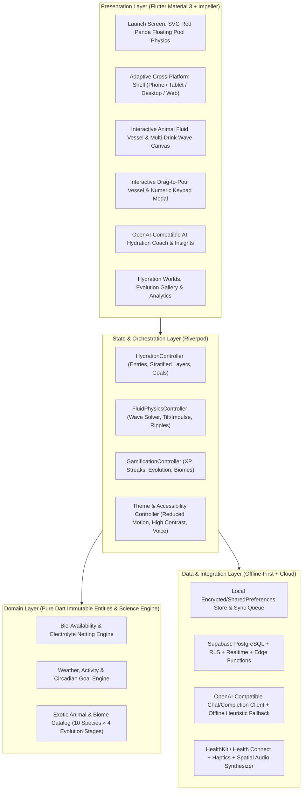

# AquaWild (HydroFauna) — Enterprise System Architecture & Competitive Analysis

## 1. Competitive Reference Image Analysis & How AquaWild Surpasses Existing Apps

### Reference Image Insights (Waterllama & Brownie Pool Concept)
1. **Reference Images 1, 2 & 4 (Waterllama iOS on Mobbin)**:
   - *Observed Strengths*: Friendly animal silhouettes (Llama, Octopus, Bear) that fill vertically from the feet up with stacked colored bands representing different beverages (blue for water, green for green tea, brown for coffee, orange for juice); quick beverage dock at the bottom; full-screen cup drag-to-adjust volume sheet (e.g., 300ml Green Tea mug, orange tumbler with vertical drag handle); custom numeric keypad (`800 ml`).
   - *Observed Limitations*:
     - Flat 2D static color clipping with minimal fluid physics (horizontal bands don't slosh dynamically with inertia, viscosity, or refraction).
     - Mobile-only portrait layout (iOS-only roots); lacks adaptive tablet, desktop, and web multi-pane experiences.
     - Aggressive paywall friction banners ("You'll lose access soon 23:57h") that degrade user trust.
     - No AI coaching, no real-time electrolyte/caffeine dehydration netting explanation, and no interactive ecosystem where unlocked animals live together.
2. **Reference Image 3 ("Brownie" Interactive Pool Mockup)**:
   - *Observed Strengths*: Top-down swimming pool tile grid with caustic lines and a cute character wearing sunglasses relaxing in a pink floating inner tube holding a citrus drink above a clean "Get Started" pill button.
   - *Observed Limitations*:
     - Static/basic web mockup with uniform grid distortion and limited physical depth.
   - *How AquaWild Surpasses It*:
     - **AAA Launch Screen — SVG Red Panda Floating Pool Simulation**: Replaces the basic mockup with a multi-layered, high-detail animated SVG **Red Panda** lounging on a buoyant ring tube over a real-time procedural top-view water surface featuring dual-layer caustic refraction waves, concentric interactive touch/cursor ripples, subsurface depth gradient, realistic drop-shadow parallax that shifts with wave height, floating blossom/bubble particles, and spring-damper buoyancy physics that seamlessly transitions into the main hydration studio.

---

## 2. System Topology & Clean Architecture Layers

---

## 3. Core Technical Subsystems

### 3.1 Real-Time 2D Shallow-Water Fluid & Multi-Beverage Stratification Engine
- **Coupled Wave Column Solver**: Models liquid surface elevation $y_i$ and vertical velocity $v_i$ across $N=64$ discrete horizontal columns using spring-damper surface tension and neighbor wave propagation:
  $$a_i = -k \cdot (y_i - y_{\text{target}}) - c_{\text{viscosity}} \cdot v_i + s \cdot (y_{i-1} + y_{i+1} - 2y_i)$$
- **Multi-Beverage Stratification**: Unlike simple single-color fills, every logged drink pushes a distinct fluid stratum (`FluidLayer`) into the active animal silhouette. Each stratum renders with:
  - Beverage-specific gradient, specular meniscus highlight, and internal micro-bubbles.
  - Subsurface interfacial waves between stacked beverages (e.g., Water → Green Tea → Espresso → Electrolyte Citrus).
- **Exotic Animal Vector Silhouettes**: Precision vector clipping paths (`Path`) and detailed anatomical overlays (eyes with blink timers, ears, whiskers, paws, tail idle motion) for **Red Panda, Capybara, Axolotl, Sea Otter, Andean Llama, Arctic Fox, Emperor Penguin, Bottlenose Dolphin, Blue-Ringed Octopus, and Snow Leopard**.

### 3.2 Launch Screen — Animated SVG Red Panda Floating Pool Engine
- **Top-View Water Simulation**:
  - Deep-to-shallow aqua gradient with procedural caustic Voronoi/sinusoidal grid lines distorted in real time by wave phase and active ripple sources.
  - Interactive ripple emitters triggered automatically by Red Panda breathing/tail movement and interactively by user tap, drag, or mouse cursor movement.
  - Projected underwater shadow of the Red Panda and float tube offset by solar angle and modulated by wave height (parallax depth effect).
- **Detailed SVG Red Panda on Floating Tube**:
  - Multi-part vector assembly: striped coral-cyan inflatable ring tube, specular wet highlights, detailed Red Panda body, ringed tail gently swaying in the water, white facial markings, cool aviator sunglasses with animated glint, and a paw holding a tropical yuzu-mint drink with bobbing ice cubes.

### 3.3 OpenAI-Compatible AI Architecture & Offline Resilience
- **Configurable OpenAI-Compatible Endpoint**: Supports any OpenAI-compatible `/v1/chat/completions` provider (OpenAI, Gemini OpenAI-compatible endpoint, Azure, local Ollama/vLLM, or Supabase Edge Function proxy) configured via environment variables or user settings.
- **Deterministic Expert Fallback**: When offline or when no external API key is supplied, a physiological Hydration Science Expert Engine computes personalized recommendations based on temperature, humidity, workout duration, caffeine intake, electrolyte deficit, and circadian time-of-day.

### 3.4 Multi-Platform Adaptive Ergonomics & Accessibility (WCAG 2.2 AA+)
- **6 Target Platforms**: Android, iOS, Web (PWA/Wasm), Windows, macOS, Linux.
- **Responsive Breakpoints**:
  - `Compact (< 600px)`: Single-column immersive habitat with floating glass beverage dock and bottom navigation.
  - `Medium (600px – 1024px)`: Navigation rail + dual-pane habitat and quick analytics/AI drawer.
  - `Expanded (> 1024px)`: Desktop/Web Command Center with 3 synchronized panes (Left: Navigation & Biome Switcher; Center: Interactive Animal Fluid Vessel & Drink Dock; Right: Live AI Coach, Weather/Biometric Telemetry & Hydration Analytics).
- **Accessibility First**:
  - Explicit `Semantics` descriptions on all custom canvases.
  - Full keyboard shortcut system (`1`–`8` quick log beverages, `Space` quick water, `P` custom pour, `R` launch Red Panda pool relaxation mode, `A` AI advisor, `M` toggle reduced motion, `H` toggle high contrast).
  - Reduced-motion mode replaces wave oscillation and particle motion with calm, instant or gentle opacity transitions.
